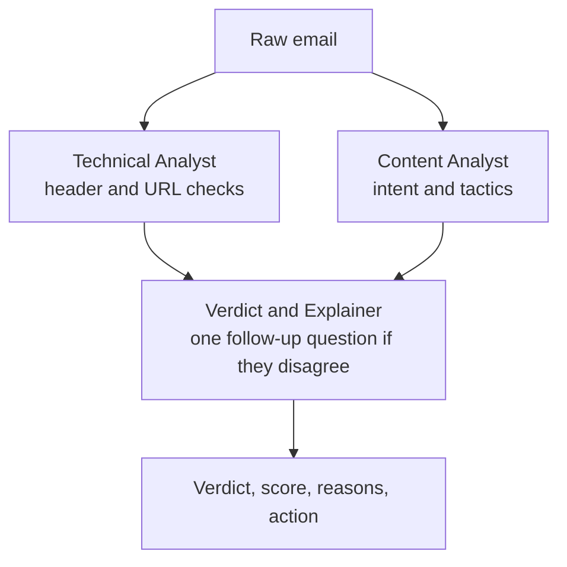

# Phishing Detection Agents

Three CrewAI agents read a raw email, decide whether it is phishing, and explain why in plain English.

[](https://colab.research.google.com/github/anriudh/phishing-detection-agents/blob/main/phishing_detection.ipynb)


For each email the system returns:

- **Verdict:** phishing, suspicious or legitimate
- **Risk score:** 0 to 100
- **Reasons:** each one tied to a quoted piece of evidence
- **Action:** what the reader should do next

## How it works



- **Technical Analyst:** deterministic, runs offline, makes no API calls.
- **Content Analyst:** reads the body only, with no headers.
- **Verdict and Explainer:** merges both reports. When the two analysts disagree, it asks one of them a single follow-up question, and only once. It drops any quote that does not appear in the email.

Every LLM response is cached on disk by model, prompt version, configuration and email, so a rerun costs nothing.

## Results

Results on 100 held-out emails (50 phishing, 50 legitimate), using `gemini-3.5-flash-lite`. A "suspicious" verdict counts as predicting phishing.

| Configuration | Precision | Recall | F1 | Gemini requests |
|---|---:|---:|---:|---:|
| Tools only (Technical Analyst) | 1.00 | 0.26 | 0.413 | 0 |
| TF-IDF + logistic regression | 0.98 | 1.00 | **0.990** | 0 |
| LLM only | 1.00 | 0.94 | 0.969 | 100 |
| Full system (three agents) | 1.00 | 0.92 | 0.958 | 276 |

Each configuration also ran on 20 modern legitimate emails:

| Configuration | False positives |
|---|---:|
| TF-IDF baseline | **17 / 20** |
| Tools only, LLM only, full system | 0 / 20 |

The baseline's near-perfect score does not carry over to modern legitimate mail. It mostly learned the gap in age between the two datasets (see [Limitations](#limitations)), not phishing signals. The agents explain their verdicts well: the four correct verdicts averaged 8.75 out of 9 on an explanation rubric. They did not, however, beat a single LLM call on accuracy.

The slides are in [PRESENTATION.pptx](PRESENTATION.pptx).

## Quick start (Colab)

1. Open the notebook with the **Open in Colab** badge above.
2. Add a Gemini API key in Colab Secrets (the key icon in the sidebar) as `GEMINI_API_KEY`, and turn on notebook access for it.
3. Choose **Runtime → Run all** and allow Google Drive access when Colab asks. The notebook stores its data and cache in `MyDrive/phish_project/`.

A run with an empty cache uses about 420 Gemini requests, and the free tier allows 500 a day. To skip that and reuse the cached results, run this in a new cell before **Run all**:

```python
from google.colab import drive
drive.mount("/content/drive")
repo = "https://github.com/anriudh/phishing-detection-agents"
!wget -q {repo}/releases/latest/download/phish_project_cache.zip -O /content/cache.zip
!unzip -q -o /content/cache.zip -d /content/restore
!mkdir -p /content/drive/MyDrive/phish_project
!cp -r /content/restore/cache /content/restore/results /content/drive/MyDrive/phish_project/
```

Unzip into `/content` first, then copy into Drive. Unzipping straight into Drive can leave folders you cannot read. With the cache in place, every LLM stage should report `0 new requests`.

<details>
<summary>Running locally</summary>

1. Create a Python 3.13 venv and install `requirements.txt` into it.
2. Create a `.env` file next to the notebook containing one line: `GEMINI_API_KEY=...` (git ignores this file).
3. Run `python run_notebook.py`, or add `--until "Checkpoint 2"` to stop early.

When run locally, data, cache and results go in `runtime/` instead of Google Drive.
</details>

## Repository

| File | What it is |
|---|---|
| [`phishing_detection.ipynb`](phishing_detection.ipynb) | The whole pipeline in 12 stages, each ending in a checkpoint cell |
| [`run_notebook.py`](run_notebook.py) | Runs the notebook outside Jupyter |
| [`PRESENTATION.pptx`](PRESENTATION.pptx) | 10 slides with speaker notes |

## Limitations

- **Data from different eras.** The phishing emails date from 2023 to 2025, and the legitimate ones from about 2002. To reduce the effect, the notebook removes date, routing and authentication headers from what the baseline and the LLM-only configuration see. The robustness check covers only 20 emails, and Claude wrote them.
- **Passing authentication reads as reassurance.** In three of the four misses, the first reason given is that SPF, DKIM or DMARC passed.
- **The follow-up round can hurt.** Three of the four label changes it caused lowered the risk score. One of them turned a correct "suspicious" into a miss.
- **Attachments are not read.** One miss had its phishing content in a `.htm` attachment.
- **The sample is small:** 100 emails, one model and one prompt version.

## Data

The notebook downloads the data at run time. No email data is stored in this repo.

| Source | Used as | License |
|---|---|---|
| [Nazario phishing corpus](https://monkey.org/~jose/phishing/), 2023–2025 | Phishing | CC-BY-4.0, by Jose Nazario |
| [SpamAssassin public corpus](https://spamassassin.apache.org/old/publiccorpus/): easy_ham, easy_ham_2, hard_ham | Legitimate | No formal license; published for testing spam filters |

Only public or synthetic emails are sent to Gemini. Google may use free-tier inputs to improve its models.
